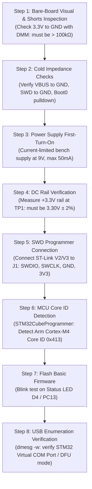

# STM32F4 4-Layer Development Board: Engineering Design Considerations & Bring-Up Guide

**Project**: STM32F4 4-Layer Reference Development Board (`STM32F4_REV2`)  
**Target Hardware**: STMicroelectronics STM32F405RGT6 (Arm Cortex-M4, 168 MHz, 1MB Flash, 192KB SRAM)  
**Board Architecture**: 4-Layer High-Density Stackup (Signal - Solid GND - Solid Power - Signal)  
**Team Members**: 
- Divyansh Rawat (Roll No: 124EC0030) - Lead Hardware & Validation Engineer
- Rehan Afroz (Roll No: 124EC0032)
- Ishan Pandey (Roll No: 124EC0033)  
**Attribution & Provenance**: Adapted and re-routed from the open-source STM32F4 Reference Design by Philip Salmony (Phil's Lab), licensed under the MIT License.

---

## 1. Executive Summary & Verification Scope

This document details the engineering considerations, hardware caveats, circuit calculations, and physical bench bring-up procedures for the STM32F4 4-layer development board.

All software-level automated design rule checks (DRC), electrical rules checks (ERC), and schematic parity tests have been completed and verified clean in **KiCad 9.0.8**:
- **ERC Status**: 0 Violations, 0 Errors, 0 Warnings
- **DRC Status**: 0 Violations, 0 Errors, 0 Warnings, 0 Unconnected Pads
- **Schematic-to-PCB Parity**: 100% Match (0 discrepancies)
- **Power Plane Verification**: Solid, unbroken ground plane on Layer 2 (`In1.Cu`) and solid +3.3V plane on Layer 3 (`In2.Cu`)

> [!IMPORTANT]
> **Boundary of Software Verification**: Passing software rule checks confirms that the schematic connectivity and physical copper geometries are consistent, unbroken, and conform to fabrication constraints. Software rule checkers **cannot** validate analog margins, parasitics, or unbuilt hardware dynamics. The physical caveats outlined below must be verified on a fabricated physical prototype.

---

## 2. Power Subsystem & Low-Line USB Margin Analysis

### A. Dual-Input Power Architecture
The board supports two power sources with automatic auctioneering:
1. **External DC Input (`J3`)**: 2-pin screw terminal rated for 7V to 24V DC. Protected by reverse-polarity diode `D3` (B5819W).
2. **USB-C Bus Power (`J5`)**: 5V nominal from standard USB host or power adapter. Protected by Schottky diode `D1` (B5819W), PTC fuse `F1` (250 mA hold), and ferrite bead `FB1` (600Ω @ 600 MHz).
3. **Primary Step-Down Regulator (`U2`)**: MPS MP2359 1.2A, 1.4 MHz high-efficiency step-down buck converter stepping input voltage down to +3.3V.

### B. USB Low-Line Input Margin (Physical Caveat)
* **Datasheet Specification**: The MP2359 step-down regulator requires a minimum operating input voltage $V_{\text{IN(MIN)}} = 4.5\text{ V}$.
* **Worst-Case USB Condition**: A compliant USB 2.0 host or unpowered hub under load is allowed to drop to $V_{\text{USB(MIN)}} = 4.75\text{ V}$.
* **Calculated Component Drops**:
  - Schottky Diode `D1` (B5819W): $V_F \approx 0.35\text{ V}$ to $0.42\text{ V}$ at $100\text{--}150\text{ mA}$.
  - PTC Resettable Fuse `F1`: Cold DC resistance $R \approx 0.6\text{ }\Omega$ to $1.2\text{ }\Omega$, contributing $\Delta V \approx 0.08\text{ V}$ to $0.15\text{ V}$ under operating load.
  - Ferrite Bead `FB1`: DC resistance $R_{\text{DCR}} \approx 0.3\text{ }\Omega$, contributing $\Delta V \approx 0.04\text{ V}$.
* **Resulting Input Voltage at Regulator**:
  $$V_{\text{IN, U2}} = V_{\text{USB}} - (\Delta V_{D1} + \Delta V_{F1} + \Delta V_{FB1})$$
  $$V_{\text{IN, U2}} = 4.75\text{ V} - (0.40\text{ V} + 0.12\text{ V} + 0.04\text{ V}) \approx 4.19\text{ V}$$

> [!WARNING]
> **Engineering Finding**: Under minimum USB host supply conditions ($4.75\text{ V}$), the voltage reaching the MP2359 input pin falls below its $4.5\text{ V}$ nominal specification into the $4.15\text{--}4.25\text{ V}$ range. While the regulator typically operates into dropout before under-voltage lockout (UVLO) triggers, line and load regulation cannot be guaranteed by software.
> 
> **Resolution & Action**:
> 1. Use the **External DC Terminal (`J3`)** with a $9\text{V}$ or $12\text{V}$ power brick for production, high-current, or analog-sensitive testing.
> 2. For USB-only bench bring-up, test supply voltage at test point `TP1` / input capacitor `C13` with a calibrated bench multimeter to ensure the rail exceeds $4.5\text{ V}$.

---

## 3. High-Speed Crystal (HSE) Oscillator & AN2867 Analysis

### A. Component Parameters
- **Crystal Oscillator (`Y1`)**: 16.000 MHz fundamental-mode crystal (JLCPCB Part C13738 / Yangxing Technology).
- **Nominal Specified Load Capacitance**: $C_L = 9.0\text{ pF}$.
- **Selected Board Capacitors**: $C_{15} = C_{16} = 12.0\text{ pF}$ (0402 C0G/NP0 ceramic).

### B. Effective Load Capacitance Calculation
The effective circuit load capacitance presented to the crystal is given by:
$$C_{\text{L,eff}} = \frac{C_{15} \times C_{16}}{C_{15} + C_{16}} + C_s$$
where $C_s$ is the total stray capacitance from MCU package pins and PCB traces.

Substituting values:
$$C_{\text{L,eff}} = \frac{12 \times 12}{12 + 12}\text{ pF} + C_s = 6.0\text{ pF} + C_s$$

For $C_{\text{L,eff}}$ to match the crystal's specified $9.0\text{ pF}$:
$$C_s = 9.0\text{ pF} - 6.0\text{ pF} = 3.0\text{ pF}$$

### C. ST AN2867 Oscillator Design Verification
According to ST Application Note **AN2867** (*Oscillator design guide for STM32 microcontrollers*):
1. **Stray Capacitance on 4-Layer FR4**: A compact differential layout with a ground plane directly beneath on Layer 2 yields $C_s \approx 2.5\text{--}3.5\text{ pF}$. Thus, $12\text{ pF}$ capacitors provide a proper nominal center frequency.
2. **Gain Margin Criterion**: The transconductance $g_m$ of the STM32F405 HSE oscillator driver exceeds $25\text{ mA/V}$. The critical transconductance for startup:
   $$g_{\text{mcrit}} = 4 \times ESR \times (2\pi f)^2 \times (C_0 + C_L)^2$$
   With $ESR \approx 40\text{ }\Omega$ and shunt capacitance $C_0 \approx 2\text{ pF}$, $g_{\text{mcrit}} \approx 1.8\text{ mA/V}$.
   The gain margin ratio is:
   $$\text{Margin} = \frac{g_m}{g_{\text{mcrit}}} \approx \frac{25}{1.8} \approx 13.8 \gg 5$$
   The oscillator design safely exceeds the ST AN2867 robustness margin ($> 5$).

---

## 4. Signal Integrity, High-Speed Return Paths & EMC

```
Stackup Architecture:
Layer 1: F.Cu       ─── Component Pads & High-Speed Traces (USB D+/D-, SWD, Status)
Layer 2: In1.Cu     ─── Solid Ground Plane (Continuous 0V Reference Plane)
Layer 3: In2.Cu     ─── Solid +3.3V Power Plane (Continuous DC Distribution)
Layer 4: B.Cu       ─── Non-Critical Signals & Ground Flood
```

### A. Buck Switching Current Loop (Hot Loop)
The MP2359 operates at a high switching frequency of $1.4\text{ MHz}$. The critical high-frequency "hot loop" consists of:
- Internal High-Side MOSFET (`U2` pin 5/6)
- Catch Diode `D2` (B5819W SOD-123)
- Switching Inductor `L2` (4.7 µH SMD)
- Input bypass capacitor `C13` (10 µF) & Output filter `C5` (4.7 µF)

**Mitigation in Layout**:
All components in this loop are placed on the top layer with minimal trace lengths. Layer 2 (`In1.Cu`) directly beneath this circuitry is a 100% solid, un-slotted ground plane. High-frequency image currents mirror the switching path directly beneath the traces, preventing inductive ground bounce and radiated EMI.

### B. USB 2.0 Full-Speed Differential Pair
- The USB data lines `USB_D+` and `USB_D-` are routed as a closely coupled differential pair from connector `J5` through ESD protection array `U3` to MCU pins `PA11` and `PA12`.
- Continuous reference: Traces maintain continuous ground reference over `In1.Cu` without crossing any split planes or zone voids.
- Series termination: Resistors `R1` and `R2` ($22\text{ }\Omega$) provide source-impedance matching against line reflections.

---

## 5. Firmware Configuration & Peripheral Interfacing Caveats

### A. USB VBUS Sensing (`PA9`)
- **Circuit State**: $5\text{V}$ VBUS powers the board through diode `D1`, but VBUS is **not** connected to MCU pin `PA9` (`OTG_FS_VBUS`).
- **Firmware Requirement**:
  By default, the ST USB Device Middleware and standard HAL drivers enable hardware VBUS sensing on pin `PA9`. If VBUS sensing is enabled in software without physical pin connection, the USB peripheral will believe no cable is plugged in and will **fail to enumerate**.
- **Mandatory Firmware Setting**:
  In `main.c` / `usbd_conf.c`, disable VBUS sensing to force device enumeration:
  ```c
  hpcd_USB_OTG_FS.Init.vbus_sensing_enable = DISABLE;
  ```

### B. USB Connector Shield Grounding (`J5`)
- In `STM32F4_REV2.kicad_pcb`, the 4 outer mounting tabs of USB connector `J5` are harmonized under a dedicated shield net.
- **EMC Recommendation**: For laboratory testing, the shield can remain tied to chassis or decoupled to circuit GND via a parallel RC network ($1\text{ M}\Omega \parallel 4.7\text{ nF}$, $1\text{ kV}$) to provide an ESD discharge path without creating ground loops.

---

## 6. Physical Hardware Bench Bring-Up Checklist

When unpopulated and populated physical boards arrive from the fabrication house, execute the following step-by-step procedure:



### Detailed Bring-Up Steps:
1. **Cold Resistance Checks (Before applying power)**:
   - Measure resistance between `+3.3V` and `GND` across capacitor `C5`: Must measure high impedance ($> 100\text{ k}\Omega$). A low reading ($< 5\text{ }\Omega$) indicates a solder bridge under the LQFP-64 MCU or buck regulator.
   - Measure resistance between `VBUS` and `GND` across capacitor `C13`: Must measure $> 100\text{ k}\Omega$.
2. **Current-Limited Power-Up**:
   - Set bench power supply to $9.0\text{ V}$ with current limit set to $50\text{ mA}$.
   - Apply power to terminal block `J3`. Power LED `D3` (Red) must illuminate immediately.
   - Measure current draw: A bare, unprogrammed MCU with regulator draws only $10\text{--}18\text{ mA}$.
3. **Regulator Rail Check**:
   - Measure DC voltage at `C5`: Must read $+3.30\text{ V} \pm 0.05\text{ V}$.
   - Verify ripple with an oscilloscope: Switching ripple should measure $< 30\text{ mV}_{\text{p-p}}$ at $1.4\text{ MHz}$.
4. **SWD Programming Check**:
   - Connect ST-Link / J-Link to header `J1` (`SWCLK`, `SWDIO`, `GND`, `3V3`).
   - Launch `STM32CubeProgrammer` (or OpenOCD):
     ```bash
     openocd -f interface/stlink.cfg -f target/stm32f4x.cfg
     ```
   - Confirm Target Voltage reads $3.3\text{ V}$ and MCU Device ID reads `0x413` (STM32F405xx/F415xx).
5. **Firmware Verification**:
   - Program a test binary toggling pin `PC13` at $1\text{ Hz}$. Status LED `D4` (Blue) must toggle.
   - Check crystal oscillation at `OSC_IN` (`PH0`) with a low-capacitance active probe: verify a clean $16.000\text{ MHz}$ sine wave.

---

## 7. Submission Package Integrity & Manifest

The official submission archive **`STM32F4 4-Layer Development Board/`** contains only clean, validated files:

| Folder / File | Description | Verification Status |
| :--- | :--- | :-: |
| `manufacturing/STM32F4_REV2_gerbers.zip` | 4-layer production Gerber & drill archive | **Verified (Clean)** |
| `manufacturing/STM32F4_REV2_bom.csv` | Reconciled manufacturing Bill of Materials | **Verified (Clean)** |
| `manufacturing/STM32F4_REV2_pos.csv` | Pick-and-place component centroid data | **Verified (Clean)** |
| `manufacturing/ibom.html` | Self-contained Interactive HTML BOM | **Verified (Clean)** |
| `manufacturing/STM32F4_REV2_schematic.pdf` | Vector schematic diagram plot | **Verified (Clean)** |
| `manufacturing/STM32F4_REV2.pdf` | 4-layer PCB layout graphics plot | **Verified (Clean)** |
| `manufacturing/STM32F4_REV2_3d.png` | 3D visual render of current assembly | **Verified (Clean)** |
| `STM32F4_REV2.kicad_sch` | Native KiCad 9 schematic source | **0 ERC Violations** |
| `STM32F4_REV2.kicad_pcb` | Native KiCad 9 board layout source | **0 DRC Violations** |
| `STM32F4_REV2.kicad_pro` | Project configuration & rules | **Parity Verified** |
| `STM32F4_REV2.kicad_sym` | Embedded project symbol library table | **Verified** |
| `LICENSE` | MIT License with attribution to Philip Salmony | **Verified** |
| `DESIGN_CONSIDERATIONS.md` | Full engineering analysis & bring-up guide | **Documented** |
| `PRESENTATION.md` | Project presentation & review deck | **Documented** |

*Note: Stale `assembly/` files, old `.rar` Gerber archives, and legacy `.sch/.pro/.xml` files have been quarantined and excluded from the submission package.*
