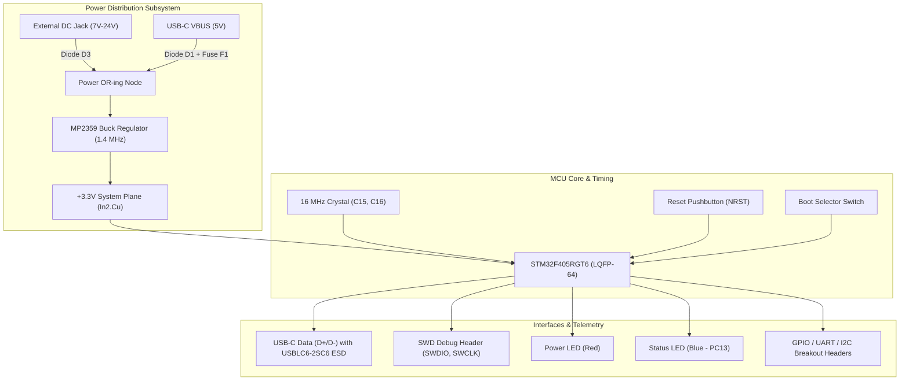

# Presentation: STM32F4 4-Layer Development Board

**Course / Subject**: Electronics Manufacturing & PCB Design (EMP)  
**Project Title**: STM32F4 4-Layer High-Performance Development Board  
**Team Members**:
- **Divyansh Rawat** (Lead Hardware & Layout Engineer) — Roll No: **124EC0030**
- Rehan Afroz — Roll No: **124EC0032**
- Ishan Pandey — Roll No: **124EC0033**  
**Design Attribution**: Adapted and re-routed from Phil's Lab's open-source STM32F4 reference design under the MIT License.

---

## Slide 1: Executive Overview & Objectives

* **Core Processor**: STMicroelectronics **STM32F405RGT6** (32-bit ARM Cortex-M4 RISC core running up to 168 MHz with Hardware FPU, 1 MB Flash, 192 KB SRAM).
* **Stackup**: Professional 4-Layer High-Density Stackup (`Signal` - `Solid GND` - `Solid Power` - `Signal`).
* **Design Philosophy**:
  - Industrial power input (7V to 24V DC) with onboard high-efficiency synchronous buck regulation.
  - Full-Speed USB 2.0 interface with dedicated USBLC6-2SC6 ESD protection.
  - Robust 16 MHz external crystal oscillator design conforming to ST AN2867 standards.
  - Standardized 4-pin SWD programming header with hardware reset and status telemetry.
* **Verification Status**: **100% Clean Pass** in KiCad 9 (0 ERC violations, 0 DRC violations, 0 unconnected items, 100% schematic/PCB parity).

---

## Slide 2: Hardware Architecture & Subsystems



---

## Slide 3: Circuit Subsystems & Schematic Analysis

### 1. High-Efficiency Buck Power Supply
- **Regulator IC**: MPS **MP2359DJ** (1.2A step-down switching regulator operating at 1.4 MHz).
- **Protection**: Schottky diode `D1`/`D3` (reverse polarity prevention), PTC fuse `F1` (250 mA current limit), ferrite bead `FB1` (high-frequency supply filtering).
- **Feedback & Filtering**: Precision resistor divider sets output to $+3.30\text{ V}$. Low-ESR ceramic input (`10 µF`) and output capacitors (`4.7 µF` + `100 nF`) provide $< 30\text{ mV}_{\text{p-p}}$ ripple.

### 2. Microcontroller Core Decoupling
- Comprehensive per-pin decoupling: Every `VDD` pin on the LQFP-64 package has a dedicated `100 nF` ceramic bypass capacitor placed within 1.5 mm of the pin.
- Dedicated `VDDA` / `VREF+` LC analog filter network (`C11`, `C12`) ensures 12-bit ADC accuracy and noise immunity.

### 3. USB 2.0 Full-Speed Physical Interface
- **Connector**: Reversible USB Type-C connector (`J5`) with $5.1\text{ k}\Omega$ pulldown resistors on `CC1` and `CC2` for standard $5\text{V}/1.5\text{A}$ host negotiation.
- **ESD Suppression**: STMicroelectronics **USBLC6-2SC6** rail-to-rail low-capacitance ($0.6\text{ pF}$) transient voltage suppressor protecting `D+` and `D-` from $\pm 15\text{ kV}$ human-body discharges.

---

## Slide 4: 4-Layer PCB Stackup & Signal Integrity Strategy

```
Layer 1 (Top / F.Cu):       High-speed signals, component pads, decoupling loops
Layer 2 (Inner 1 / In1.Cu): Continuous 100% Solid Ground Plane (0V Reference)
Layer 3 (Inner 2 / In2.Cu): Continuous +3.3V Power Plane (Low-impedance DC distribution)
Layer 4 (Bottom / B.Cu):    Non-critical interconnects and solid ground flood
```

### Key SI/PI Design Rules Enforced:
1. **Unbroken Return Paths**: High-frequency return currents travel directly beneath top-layer traces on Layer 2 (`In1.Cu`). No traces cross splits or plane voids.
2. **Minimized Hot Loops**: The 1.4 MHz switching current loop of the buck regulator (IC switch -> catch diode -> inductor -> output capacitor) has a perimeter under 18 mm.
3. **Controlled Differential Impedance**: USB data traces (`D+`/`D-`) are routed with matched lengths and tight 12-mil edge-to-edge spacing.
4. **Thermal Dissipation**: High-conductivity copper pours and thermal relief vias under the buck regulator and MCU carry heat to inner ground planes.

---

## Slide 5: Automated Verification & Quality Gates (KiCad 9.0.8)

All checks were executed with `--severity-all` and `--schematic-parity` flags:

| Quality Gate | Tool / Check | Requirement | Result | Status |
| :--- | :--- | :--- | :-: | :-: |
| **ERC Check** | `kicad-cli sch erc` | 0 errors, 0 warnings, 0 exclusions | **0 Violations** | **PASS** |
| **DRC Check** | `kicad-cli pcb drc` | 0 design rule violations | **0 Violations** | **PASS** |
| **Unconnected Pads** | `kicad-cli pcb drc` | 0 unrouted nets or dangling tracks | **0 Unconnected** | **PASS** |
| **Schematic Parity** | `kicad-cli pcb drc --schematic-parity` | 100% netlist and component parity | **0 Discrepancies** | **PASS** |
| **Power Planes** | `pcbnew` Zone Inspector | Both In1 (GND) & In2 (3V3) 100% poured | **Solid Pours** | **PASS** |
| **BOM / POS Parity** | Custom Reconciliation Script | 100% component value & position match | **Reconciled (46/46 SMD)** | **PASS** |

---

## Slide 6: Engineering Considerations & Physical Caveats (Beyond Software)

Honest engineering analysis of conditions that cannot be verified by software alone:

1. **USB Low-Line Voltage Margin**:
   - At minimum USB host supply ($4.75\text{ V}$), drops across Schottky diode `D1` ($0.40\text{V}$), fuse `F1` ($0.12\text{V}$), and ferrite `FB1` ($0.04\text{V}$) reduce input voltage to $\approx 4.19\text{ V}$.
   - While the external DC terminal ($7\text{--}24\text{V}$) provides ample headroom, USB-only operation requires physical bench testing to confirm the MP2359 does not drop out under peak processor loads.
2. **Crystal Oscillator Startup Margin**:
   - The 16 MHz crystal (JLCPCB C13738) specifies $C_L = 9\text{ pF}$. With $2 \times 12\text{ pF}$ board capacitors, circuit load matches nominal assuming $C_s \approx 3\text{ pF}$.
   - While ST AN2867 formulas calculate a safety margin $> 13\times$, physical oscillation frequency and startup time must be validated across operating temperatures.
3. **USB VBUS Firmware Requirement**:
   - USB VBUS is connected to power, but not routed to MCU pin `PA9` (`OTG_FS_VBUS`).
   - Software must disable hardware VBUS sensing (`vbus_sensing_enable = 0`) to allow proper USB device enumeration.

---

## Slide 7: Physical Bring-Up Checklist

A disciplined 4-stage laboratory bring-up procedure:
* **Stage 1 (Cold Resistance)**: Verify $> 100\text{ k}\Omega$ impedance across 3.3V rail and VBUS before applying power.
* **Stage 2 (Controlled Power-On)**: Power via 9V current-limited bench supply (limit 50 mA). Measure quiescent draw ($10\text{--}18\text{ mA}$) and verify 3.3V DC rail with $< 30\text{ mV}_{\text{p-p}}$ ripple.
* **Stage 3 (SWD Probe & ID Detection)**: Connect ST-Link V2/V3. Read Arm Cortex-M4 Device ID (`0x413`).
* **Stage 4 (Firmware & USB Enumeration)**: Flash blink test binary on Status LED `D4` (`PC13`). Connect USB-C and verify USB Virtual COM Port enumeration in `dmesg`.

---

## Slide 8: Submission Manifest & Deliverables

All deliverables are packaged in **`STM32F4 4-Layer Development Board/`**:
- `manufacturing/STM32F4_REV2_gerbers.zip` — Production Gerbers & Excellon drill file.
- `manufacturing/STM32F4_REV2_bom.csv` — Reconciled Bill of Materials.
- `manufacturing/STM32F4_REV2_pos.csv` — SMT pick-and-place centroid coordinates.
- `manufacturing/ibom.html` — Interactive visual assembly BOM.
- `manufacturing/STM32F4_REV2_schematic.pdf` & `STM32F4_REV2.pdf` — Full vector plots.
- `STM32F4_REV2.kicad_*` — Editable KiCad 9 source files.
- `DESIGN_CONSIDERATIONS.md` — Comprehensive technical analysis and physical bring-up guide.
- `LICENSE` — MIT License preserving Philip Salmony's attribution.
