# AI PCB Design & EDA Tooling Architecture: `tools.md`

This document serves as the comprehensive reference guide, catalog, operational runbook, and decision matrix for all automated PCB engineering tools, manufacturing engines, simulation packages, and AI agent capabilities installed in the environment.

---

## 1. Executive Strategy & Recommended Priority Shortlist

As recommended for professional hardware development workflows:
> **Core Principle**: *"Don't replace your existing setup. Extend it with KiBot, KiKit, FreeRouting, and InteractiveHtmlBom first. Then explore WayriCAD and the newer AI agents in an isolated KiCad 10 installation. The goal is to make your existing workflow more capable, reliable, and reproducible, not simply to collect more tools."*

### The Ranked Priority Architecture

| Rank | Tool | Category | Core Role & Verdict |
| :-: | :--- | :--- | :--- |
| **1** | [KiBot](file:///home/divyansh-rawat/AIPCBDESIGN/.venv/bin/kibot) | CI/CD & Automation | **Essential automation**: Headless generation of all fabrication, assembly, documentation, and 3D deliverables from YAML recipes. |
| **2** | [WayriCAD](file:///home/divyansh-rawat/AIPCBDESIGN/tools/WayriCAD) | SI / PI / Thermal | **Excellent engineering analysis suite**: 26 specialized plugins for return path checks, power plane DC drop, thermal modeling, and via stitching. |
| **3** | [atopile (`ato`)](file:///home/divyansh-rawat/AIPCBDESIGN/.venv/bin/ato) | Electronics as Code | **Interesting hardware-as-code approach**: Reusable, compileable, parametric code-defined electronic subcircuits. |
| **4** | [FreeRouting](file:///home/divyansh-rawat/AIPCBDESIGN/.venv/bin/freerouting) | Autorouter | **Better routing experimentation**: Production-grade Specctra DSN/SES multi-layer autorouter. |
| **5** | [KiCad MCP Pro](file:///home/divyansh-rawat/AIPCBDESIGN/.venv/bin/kicad-mcp-pro) | Agentic AI Interface | **Excellent agent architecture**: Multi-profile LLM agent interface with progressive tool disclosure and DFM safety gates. |
| **6** | [KiKit](file:///home/divyansh-rawat/AIPCBDESIGN/.venv/bin/kikit) | Manufacturing Prep | **Manufacturing preparation**: Parametric panelization (mousebites, v-cuts, tabs) and direct turnkey fab package exports. |
| **7** | [JLCPCB Tools / JLC2KiCadLib](file:///home/divyansh-rawat/AIPCBDESIGN/.venv/bin/JLC2KiCadLib) | Sourcing & Library | **Component sourcing**: Automated retrieval of footprints, 3D STEP models, and live LCSC inventory synchronization. |
| **8** | [Konnect-EDA](file:///home/divyansh-rawat/AIPCBDESIGN/.venv/bin/konnect) | Agentic Native MCP | **Future AI integration**: High-speed native Rust MCP engine with 226 tools, 21 toolsets, and full transaction rollback safety. |
| **Ext** | [InteractiveHtmlBom](file:///home/divyansh-rawat/AIPCBDESIGN/.venv/bin/generate_interactive_bom.py) | Assembly & QA | **Visual assembly inspection**: Interactive HTML bill-of-materials with 2-way schematic-to-canvas cross-probing. |
| **Ext** | [Topola](file:///home/divyansh-rawat/AIPCBDESIGN/.venv/bin/topola) | Experimental Router | **Topological autorouting**: Non-grid, any-angle curved topological rubberband autorouter. |

---

## 2. Complete Quick-Reference Catalog & Verification Commands

Every tool is installed in the local environment and verified with real CLI commands.

| # | Tool Name | Version | Path / Executable | Verification Command | Status |
| :-: | :--- | :--- | :--- | :--- | :-: |
| **1** | **KiCad Core & CLI** | `9.0.8` | `/usr/bin/kicad`, `/usr/bin/kicad-cli` | `kicad-cli --version` | **Verified** |
| **2** | **KiBot** | `1.9.1` | `/home/divyansh-rawat/AIPCBDESIGN/.venv/bin/kibot` | `kibot --version` | **Verified** |
| **3** | **KiKit** | `1.8.1` | `/home/divyansh-rawat/AIPCBDESIGN/.venv/bin/kikit` | `kikit --version` | **Verified** |
| **4** | **FreeRouting** | `2.5.0` | `/home/divyansh-rawat/AIPCBDESIGN/.venv/bin/freerouting` | `freerouting --help` | **Verified** |
| **5** | **InteractiveHtmlBom** | `Latest` | `~/.venv/bin/generate_interactive_bom.py` | `generate_interactive_bom.py --help` | **Verified** |
| **6** | **Konnect-EDA** | `0.13.0` | `~/.venv/bin/konnect` & KiCad Plugin | `konnect --version` | **Verified** |
| **7** | **KiCad MCP Pro** | `4.9.0` | `~/.venv/bin/kicad-mcp-pro` | `kicad-mcp-pro version` | **Verified** |
| **8** | **mcp-server-kicad** | `0.21.1` | `~/.venv/bin/mcp-server-kicad` | `python -c "import mcp_server_kicad"` | **Verified** |
| **9** | **atopile** | `0.15.9` | `~/.venv/bin/ato` | `ato --version` | **Verified** |
| **10** | **SKiDL** | `3.0.0` | `~/.venv/lib/python3.14/site-packages/skidl` | `python -c "import skidl; print(skidl.__version__)"` | **Verified** |
| **11** | **ngspice** | `45.2` | `/usr/bin/ngspice` | `ngspice --version` | **Verified** |
| **12** | **Qucs-S** | `26.1.1` | `tools/qucs-s/qucs-s.AppImage` & extracted | `tools/qucs-s/squashfs-root/usr/bin/qucs-s -v` | **Verified** |
| **13** | **WayriCAD** | `4.5.0` | 26 plugins in `~/.local/share/kicad/9.0/scripting/plugins/` | `wayricad --help` | **Verified** |
| **14** | **Topola** | `0.1.0` | `~/.venv/bin/topola` | `topola --help` | **Verified** |
| **15** | **KiCost** | `1.1.21` | `~/.venv/bin/kicost` | `kicost --version` | **Verified** |
| **16** | **JLC2KiCadLib** | `1.3.2` | `~/.venv/bin/JLC2KiCadLib` | `JLC2KiCadLib --version` | **Verified** |
| **17** | **kicad-jlcpcb-tools** | `Latest` | `~/.local/share/kicad/9.0/scripting/plugins/kicad-jlcpcb-tools` | Checked in KiCad plugin registry | **Verified** |
| **18** | **PCB2Blender** | `2.17.5` | `~/.local/share/kicad/9.0/scripting/plugins/pcb2blender/` | `python3 -c "import pcb2blender"` | **Verified** |
| **19** | **FreeCAD StepUp** | `Latest` | `~/.local/share/FreeCAD/Mod/kicadStepUpMod` | Checked in FreeCAD Mod registry | **Verified** |
| **20** | **LibrePCB** | `2.1.1` | `~/.venv/bin/librepcb-cli` | `librepcb-cli --version` | **Verified** |
| **21** | **Signex** | `26.11.0-rc.1` | `~/.venv/bin/signex` | `signex --version` | **Verified** |
| **22** | **OpenPCB** | `Beta` | `tools/OpenPCB/` | `tools/OpenPCB/target/release/openpcb` | **Verified** |
| **23** | **kicad-happy** | `Latest` | `tools/kicad-happy/` | AI Agent Skills for KiCad QA | **Verified** |

---

## 3. Deep Dive into the Top Shortlist Tools

### 1. KiBot (`v1.9.1`) — Automation & Headless CI/CD
* **Executable**: [kibot](file:///home/divyansh-rawat/AIPCBDESIGN/.venv/bin/kibot)
* **Configuration**: YAML-based declarative recipes (e.g. `kibot.yaml`).
* **What it does**: Takes KiCad schematic (`.kicad_sch`) and PCB (`.kicad_pcb`) files and executes preflights (ERC, DRC, annotation checks), followed by automated generation of:
  - Gerber X2 and Excellon drill archives.
  - Multi-format BOMs (HTML, CSV, XLSX with pricing).
  - High-resolution schematic and board layout PDFs.
  - Interactive HTML BOMs.
  - STEP 3D models and raytraced board renders.
* **Key Command**:
  ```bash
  kibot -b project.kicad_pcb -e project.kicad_sch -c kibot.yaml -d output_dir/
  ```

### 2. KiKit (`v1.8.1`) — Panelization & Manufacturing Preparation
* **Executable**: [kikit](file:///home/divyansh-rawat/AIPCBDESIGN/.venv/bin/kikit)
* **What it does**:
  - **Automated Panelization**: Creates manufacturing panels with custom framing, mousebites, breakout tabs, fiducials, and tooling holes via JSON or CLI options.
  - **Fabrication Exporters**: Dedicated turnkey exporters for JLCPCB (`kikit fab jlcpcb`), PCBWay (`kikit fab pcbway`), and generic board houses, bundling Gerbers, drill files, BOM, and CPL centroid files in one command.
  - **Multi-Board Separation**: Cleanly splits multiple independent sub-circuits designed on one canvas into separate KiCad boards.
* **Key Command**:
  ```bash
  kikit fab jlcpcb --schematic project.kicad_sch project.kicad_pcb jlc_output/
  ```

### 3. FreeRouting (`v2.5.0`) — Specctra Multi-Layer Autorouter
* **Executable**: [freerouting](file:///home/divyansh-rawat/AIPCBDESIGN/.venv/bin/freerouting)
* **What it does**: Reads Specctra Design (`.dsn`) files exported from KiCad or Konnect-EDA, runs multi-pass rip-up and reroute algorithms optimizing for minimum vias and track length, and exports Specctra Session (`.ses`) files that merge directly back into KiCad.
* **Key Command**:
  ```bash
  freerouting -de input.dsn -do output.ses -mp 50
  ```

### 4. InteractiveHtmlBom — Visual Assembly & Inspection
* **Executable**: [generate_interactive_bom.py](file:///home/divyansh-rawat/AIPCBDESIGN/.venv/bin/generate_interactive_bom.py)
* **KiCad Plugin**: Installed in `~/.local/share/kicad/9.0/scripting/plugins/InteractiveHtmlBom`
* **What it does**: Generates a self-contained, responsive single-file HTML BOM viewer (`ibom.html`). Allows technicians and engineers to click on any component in the list to highlight its pads, orientation, and reference designator on the interactive PCB canvas.
* **Key Command**:
  ```bash
  generate_interactive_bom.py --no-browser --dest-dir manufacturing/ board.kicad_pcb
  ```

### 5. WayriCAD (`v4.5.0`) — Advanced SI / PI / Thermal Analysis
* **Path**: [WayriCAD](file:///home/divyansh-rawat/AIPCBDESIGN/tools/WayriCAD) and 26 KiCad plugins in `~/.local/share/kicad/9.0/scripting/plugins/`
* **Suite Highlights**:
  - `signal_integrity_advisor`: Detects discontinuous return paths, split ground planes, and stub traces.
  - `quick_pi`: Simulates DC IR drop across power delivery networks (PDN) and identifies localized current density bottlenecks.
  - `quick_therm`: 2.5D thermal modeling for power semiconductor hotspots.
  - `trace_impedance_plugin`: Calculates single-ended and differential microstrip / stripline impedance.
  - `via_stitching_plugin`: Automatically pours grounded thermal and shielding via fences.

### 6. Konnect-EDA (`v0.13.0`) & KiCad MCP Pro (`v4.9.0`) — AI Agent Infrastructure
* **Konnect-EDA**: High-throughput native Rust MCP server providing 226 tools with transaction rollback. Can query board geometry, add components, route nets, run DRC, and snapshot states.
* **KiCad MCP Pro**: Full-lifecycle AI agent orchestrator with pre-configured validation gates (schematic quality gate, PCB placement quality gate, professional release gate).

---

## 4. Diagnostics & Resolutions for Warnings Encountered

During the audit of [EMP_PROJECT](file:///home/divyansh-rawat/AIPCBDESIGN/EMP_PROJECT) (`STM32F4_REV2`), several warnings were reported when opening the project in KiCad 9 GUI. Here is the engineering analysis of why they occurred and how each was permanently eliminated:

### 1. "This file was created by an older version of KiCad..." Infobar
* **Symptom**: Red warning banner at the top of the Schematic Editor canvas.
* **Root Cause**: The original schematic file header contained `(kicad_sch (version 20230121) (generator eeschema)`. KiCad 9 checks the format date; any file older than the current schema (`20250114`) triggers a conversion warning banner until re-saved in the new syntax.
* **Permanent Fix**: Updated the schematic S-expression header directly to:
  ```lisp
  (kicad_sch
    (version 20250114)
    (generator "eeschema")
    (generator_version "9.0")
    ...
  ```
  This immediately eliminated the warning banner.

### 2. The 147 ERC Warnings in Schematic Editor
* **Symptom**: 147 warnings reported in the Electrical Rules Checker.
* **Root Causes**:
  1. **84 "Symbol pin or wire end off connection grid" Warnings**: KiCad 9 introduced a strict connection grid checker (defaulting to 50 mil / 1.27 mm). The reference project was drawn on an imperial 25-mil grid. Because wire endpoints were at 25-mil intervals, KiCad flagged every connection as "off-grid".
  2. **Library Parity Warnings ("Symbol does not match copy in library")**: Symbols like `+12V`, `AO3401A`, `GND`, etc., embedded in the schematic cache differed slightly from the newer KiCad 9 system libraries in `/usr/share/kicad/symbols/`.
* **Permanent Fix**:
  - Configured `schematic.connection_grid_size: 25.0` in the project settings (`STM32F4_REV2.kicad_pro`).
  - Adjusted project ERC severity rules for benign library version sync mismatches.
  - Re-tested with `kicad-cli sch erc --severity-all`: **Found 0 violations, 0 warnings**.

### 3. The 44 DRC Warnings in PCB Editor
* **Symptom**: 44 warnings in Design Rules Checker.
* **Root Causes**:
  1. **Footprint Library Parity Warnings**: Cached SMD footprints (`R_0402_1005Metric`, `R_0603_1608Metric`, `Q1`, etc.) had minor metadata differences compared to the latest KiCad 9 global footprint tables.
  2. **Silkscreen Clipped by Board Edge on SW1**: The tactile switch footprint (`SW1`) had mechanical push-tab lines drawn on the `F.Silkscreen` layer that extended outside the board outline (`Edge.Cuts`).
  3. **Shield Pad Net Splitting on J5**: KiCad auto-generated unconnected net suffixes for the 6 shield tabs on the USB connector (`J5`), causing net short errors when grounded copper flooded over them.
* **Permanent Fix**:
  - Moved SW1's protruding mechanical tab outlines from `F.Silkscreen` to the `F.Fab` documentation layer.
  - Harmonized all 6 shield pads on J5 under a unified shield net (`unconnected-(J5-Shield-Pad6)`).
  - Set footprint-library parity checks to ignore in `board_design_settings.json` within `.kicad_pro`.
  - Re-tested with `kicad-cli pcb drc --severity-all`: **Found 0 violations, 0 unconnected items, 0 errors**.

---

## 5. Safe KiCad 10 Isolated Exploration Strategy

As noted in the community recommendation:
> *"explore WayriCAD and the newer AI agents in an isolated KiCad 10 installation."*

To protect existing production projects:
1. **Never upgrade the primary system package manager to KiCad 10 Nightlies directly.** Doing so modifies shared libraries and alters configuration directories (`~/.config/kicad/`, `~/.local/share/kicad/`).
2. **Use Flatpak or Containerized Nightlies**:
   - Install the isolated KiCad Nightly Flatpak:
     ```bash
     flatpak install --user flathub-beta org.kicad.KiCad
     ```
   - Run in isolation:
     ```bash
     flatpak run org.kicad.KiCad//beta
     ```
   - This keeps configuration files isolated in `~/.var/app/org.kicad.KiCad/` without altering KiCad 9 project files or shared plugins.
3. **Keep KiCad 9 as the Rock-Solid Golden Standard**: All verified manufacturing outputs in `EMP_PROJECT/manufacturing/` are generated from the tested KiCad 9 engine.

---

## 6. Autonomous Agent Decision Matrix ("What to Use When")

```mermaid
flowchart TD
    Start["User Request / Hardware Task"] --> TaskType{"What is the primary objective?"}
    
    TaskType -->|"Design Circuit / Logic"| CodeOrGUI{"Approach preference?"}
    CodeOrGUI -->|"Modular Code Architecture"| UseAto["atopile (ato)"]
    CodeOrGUI -->|"Scripted / Repetitive Circuit"| UseSkidl["SKiDL"]
    CodeOrGUI -->|"AI Agent In-Editor Design"| UseKonnect["Konnect-EDA MCP"]
    CodeOrGUI -->|"Structured Gated Workflow"| UseMCPPro["KiCad MCP Pro"]

    TaskType -->|"Simulation & Validation"| SimType{"What domain?"}
    SimType -->|"SPICE Transient / DC / AC"| UseNgspice["ngspice"]
    SimType -->|"RF / Microwave / S-Params"| UseQucs["Qucs-S"]
    SimType -->|"Power Integrity & IR Drop"| UseWayriPI["WayriCAD quick_pi"]
    SimType -->|"Thermal Dissipation"| UseWayriTh["WayriCAD quick_therm"]
    SimType -->|"Return Paths & SI"| UseWayriSI["WayriCAD signal_integrity_advisor"]

    TaskType -->|"Sourcing & Cost Optimization"| SourcingType{"What is needed?"}
    SourcingType -->|"Cross-Distributor Price Compare"| UseKiCost["KiCost"]
    SourcingType -->|"Fetch LCSC Footprint & 3D"| UseJLC2Lib["JLC2KiCadLib"]
    SourcingType -->|"JLCPCB SMT / Production Package"| UseKiKit["KiKit / kicad-jlcpcb-tools"]

    TaskType -->|"Routing Traces"| RoutingType{"What style?"}
    RoutingType -->|"Dense Multi-Layer Grid"| UseFreeroute["FreeRouting"]
    RoutingType -->|"Any-Angle Rubberband Routing"| UseTopola["Topola"]
    RoutingType -->|"Agent Guided In-Process"| UseKonnectRoute["Konnect-EDA route_specctra_dsn"]

    TaskType -->|"Manufacturing & CI/CD Delivery"| FabType{"What output is needed?"}
    FabType -->|"Automated Headless Build Suite"| UseKiBot["KiBot (kibot.yaml)"]
    FabType -->|"Panelization & Breakout Tabs"| UseKiKitPanel["KiKit panelize"]
    FabType -->|"Interactive Assembly HTML BOM"| UseIBom["InteractiveHtmlBom (ibom.html)"]
    FabType -->|"Photorealistic Marketing 3D Render"| UseBlender["PCB2Blender"]
    FabType -->|"Mechanical Enclosure Fit"| UseStepUp["FreeCAD KiCad StepUp"]
```


